# 🥄 Sazón — Recetario y costeo para emprendedores gastronómicos

**Sazón** es una app pensada para emprendedores gastronómicos: reposteros, cocineros,
catering, food trucks y productores artesanales de alimentos. Combina en un solo
lugar:

- Un **recetario virtual** (ingredientes, pasos, fotos, tiempos, rendimiento).
- El **cálculo automático del costo de producción** de cada receta.
- Un **cotizador** que sugiere el precio de venta según el margen de ganancia
  que el productor quiere obtener, descontando impuestos y comisiones de venta.
- Un **panel de rentabilidad** para comparar qué recetas convienen más.

Cada usuario se registra con su propio usuario y contraseña, y ve únicamente
sus propias recetas, ingredientes y cotizaciones.

> **Estado del proyecto: MVP / prototipo funcional.**
> Todo lo descripto en este README funciona de verdad — podés abrir la app,
> crear una cuenta y probarlo. Lo que todavía no tiene es un backend propio:
> los datos se guardan en el navegador de cada usuario (ver sección
> [Estado y limitaciones](#estado-y-limitaciones)).

---

## Tabla de contenidos

- [Demo rápida](#demo-rápida)
- [Instructivo de uso](#instructivo-de-uso)
  1. [Instructivo de bienvenida](#1-instructivo-de-bienvenida)
  2. [Crear tu cuenta](#2-crear-tu-cuenta)
  3. [Cargar tus ingredientes](#3-cargar-tus-ingredientes)
  4. [Cargar costos indirectos](#4-cargar-costos-indirectos-opcional)
  5. [Armar una receta](#5-armar-una-receta)
  6. [Pantalla de Inicio](#6-pantalla-de-inicio)
  7. [Cotizar un precio de venta](#7-cotizar-un-precio-de-venta)
  8. [Panel de Rentabilidad](#8-panel-de-rentabilidad)
  9. [Configuración](#9-configuración)
  10. [Uso desde el celular](#10-uso-desde-el-celular)
- [Cómo correr el proyecto](#cómo-correr-el-proyecto)
- [Estructura del repo](#estructura-del-repo)
- [Cómo funciona el cálculo](#cómo-funciona-el-cálculo)
- [Estado y limitaciones](#estado-y-limitaciones)
- [Roadmap](#roadmap)

---

## Demo rápida

`index.html` es una aplicación completa de una sola página (sin instalación,
sin servidor, sin dependencias). Para probarla:

1. Descargá o cloná este repositorio.
2. Abrí el archivo `index.html` con cualquier navegador moderno (Chrome, Edge,
   Firefox, Safari).
3. Seguí el instructivo que aparece en pantalla.

También podés activar **GitHub Pages** en este repo (Settings → Pages → rama
`main`, carpeta `/`) para tener un link público navegable sin descargar nada.

---

## Instructivo de uso

### 1. Instructivo de bienvenida

Cada vez que se abre la app sin una sesión iniciada, aparece primero un
instructivo tipo carrusel que explica qué hace Sazón: recetario, ingredientes,
costos indirectos, cotizador y rentabilidad. Se navega con una flechita que
desliza las pantallas de derecha a izquierda, o se puede saltar directamente.

<p align="center">
  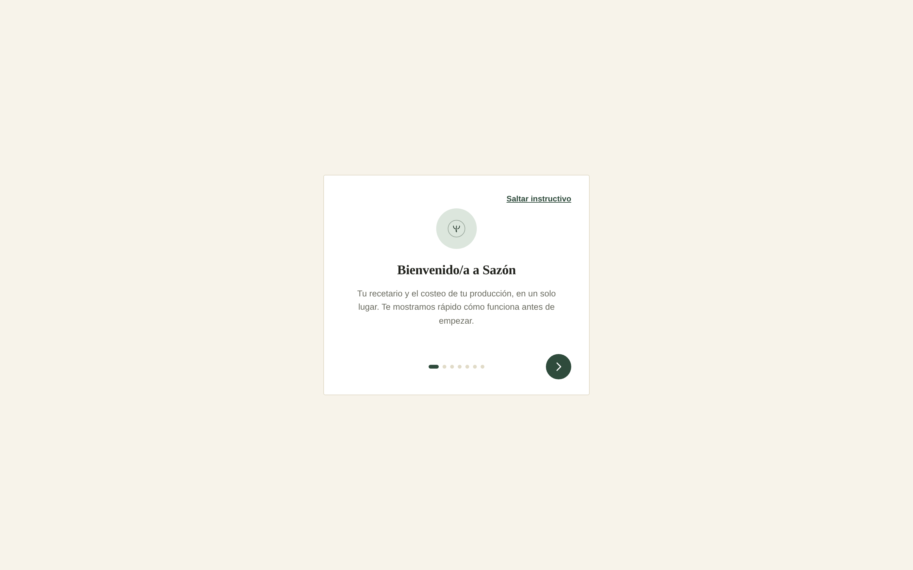
  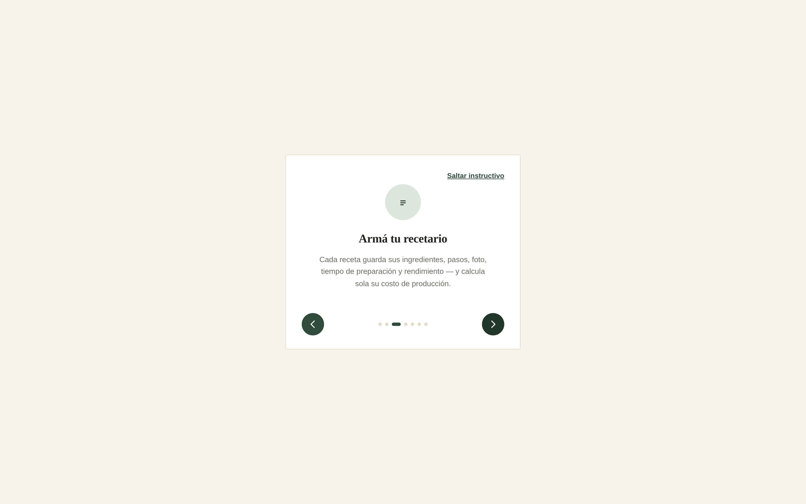
</p>
<p align="center">
  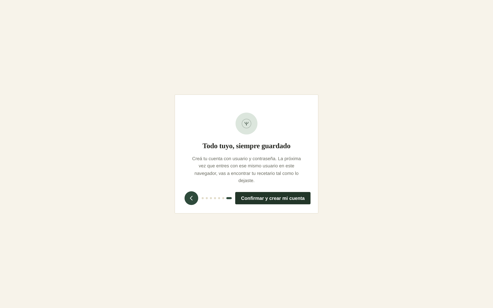
</p>

### 2. Crear tu cuenta

Al confirmar el instructivo (o si ya lo viste antes y tocás "Saltar"), se llega
a la pantalla de acceso. Ahí se crea una cuenta con usuario y contraseña
propios — no hace falta email ni verificación, es un registro simple pensado
para el prototipo.

<p align="center">
  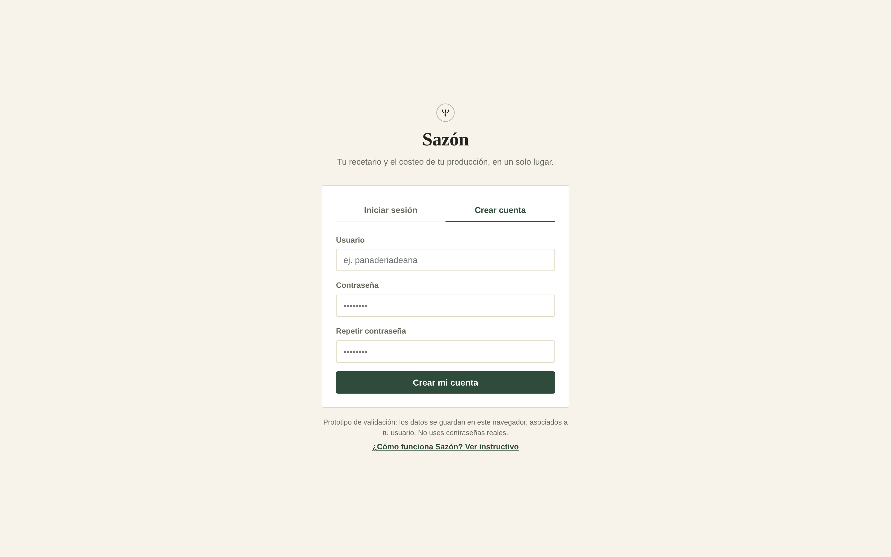
</p>

### 3. Cargar tus ingredientes

Desde **Ingredientes** se registra lo que se compra: nombre, cantidad y
unidad de compra, y el precio pagado. La app calcula sola el costo por
gramo, mililitro o unidad — ese valor es el que después usa cualquier receta
que incluya ese ingrediente.

<p align="center">
  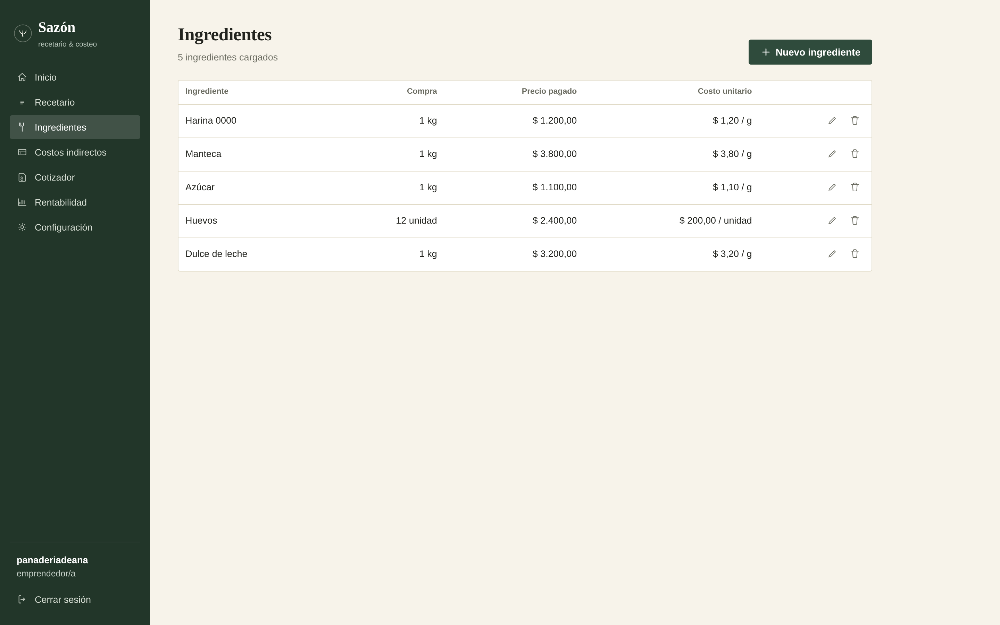
</p>

Si más adelante cambia el precio de un ingrediente, alcanza con editarlo una
vez: todas las recetas que lo usan recalculan su costo automáticamente.

### 4. Cargar costos indirectos (opcional)

Desde **Costos indirectos** se cargan gastos de producción que no son un
ingrediente puntual (packaging, gas, mano de obra, alquiler prorrateado,
etc.), ya sea como monto fijo por lote o como monto ya calculado por unidad.

### 5. Armar una receta

Cada receta guarda nombre, categoría, foto, tiempo de preparación,
rendimiento (cuántas unidades da), la lista de ingredientes con sus
cantidades, los costos indirectos que le correspondan y los pasos de
preparación. El costo de producción (directo + indirecto, total y por
unidad) se recalcula en vivo a medida que se completa el formulario.

<p align="center">
  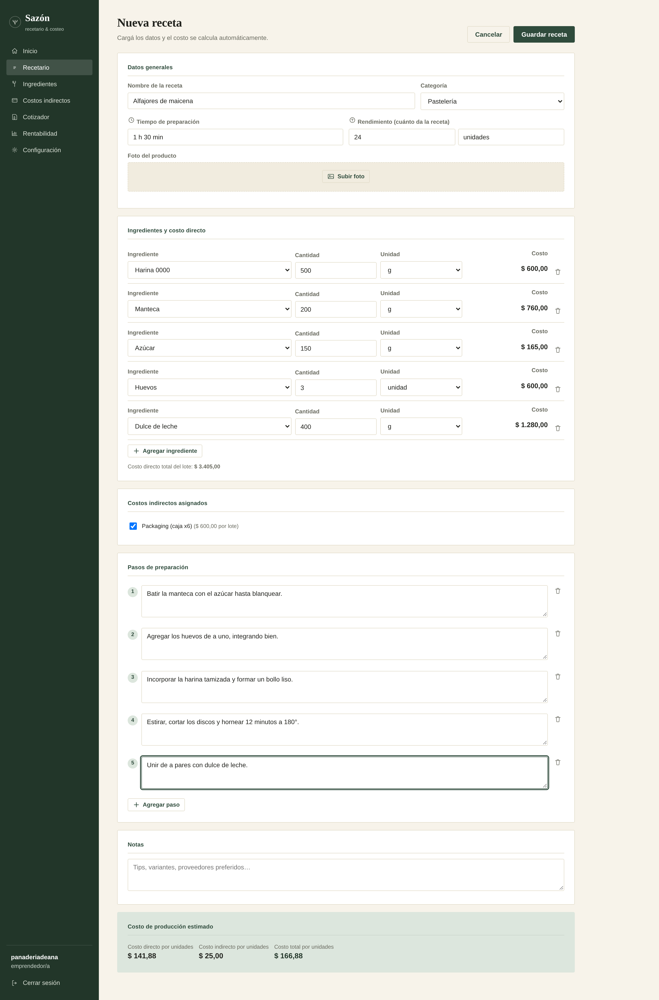
</p>

Una vez guardada, la receta aparece en el recetario con su foto y su costo
por unidad:

<p align="center">
  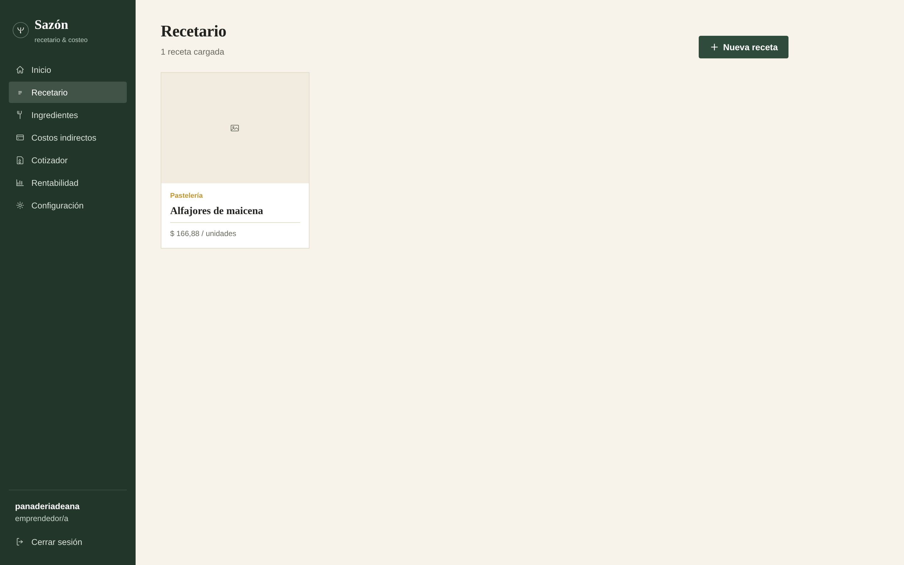
</p>

### 6. Pantalla de Inicio

Es lo primero que se ve al entrar ya logueado: cuántas recetas, ingredientes
y costos indirectos hay cargados, cuándo se guardó por última vez, y accesos
directos a las últimas recetas.

<p align="center">
  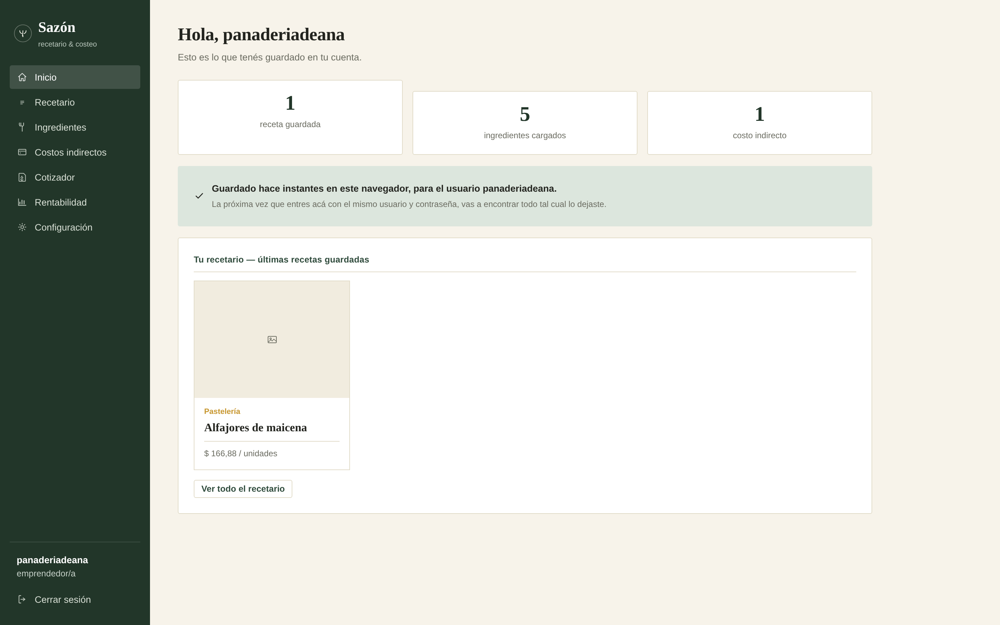
</p>

### 7. Cotizar un precio de venta

Desde **Cotizador** se elige una receta, un canal de venta (cada uno con su
comisión) y el margen de ganancia deseado — sobre el costo o sobre el precio
de venta. La app devuelve el precio sugerido, la ganancia neta por unidad y
por lote, y ambos márgenes (sobre costo y sobre venta) por separado, porque
son números distintos y es fácil confundirlos.

<p align="center">
  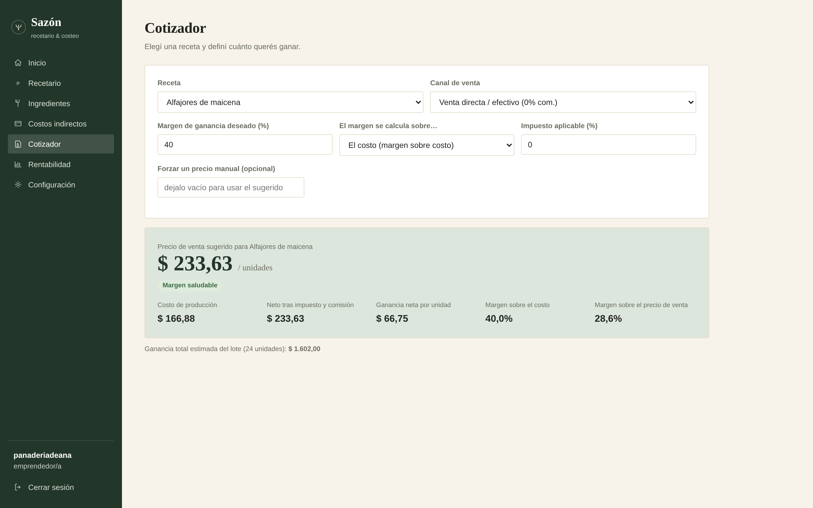
</p>

También se puede forzar un precio manual y ver qué margen real queda con ese
precio.

### 8. Panel de Rentabilidad

Compara todas las recetas ordenadas por margen, con un indicador visual de
cuáles están por debajo del margen mínimo que se definió en Configuración.

<p align="center">
  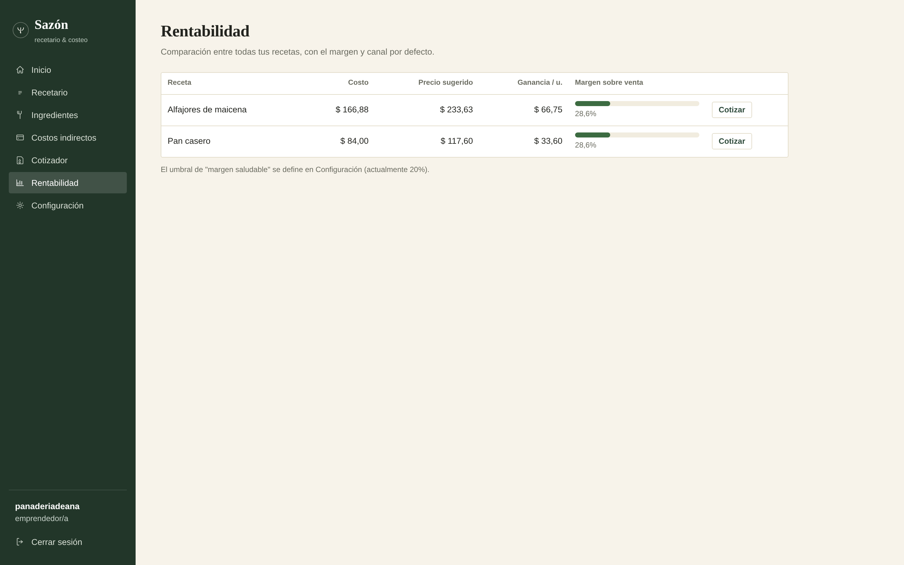
</p>

### 9. Configuración

Moneda (multi-moneda), margen e impuesto por defecto, margen mínimo
aceptable para las alertas, y los canales de venta con su comisión. Desde acá
también se puede volver a ver el instructivo de bienvenida en cualquier
momento.

<p align="center">
  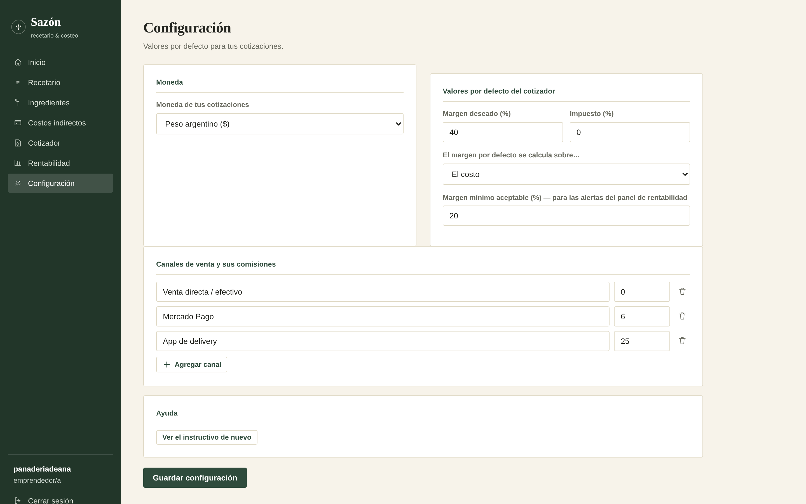
</p>

### 10. Uso desde el celular

La interfaz es responsive: en pantallas chicas el menú lateral se convierte
en un botón de menú arriba a la izquierda.

<p align="center">
  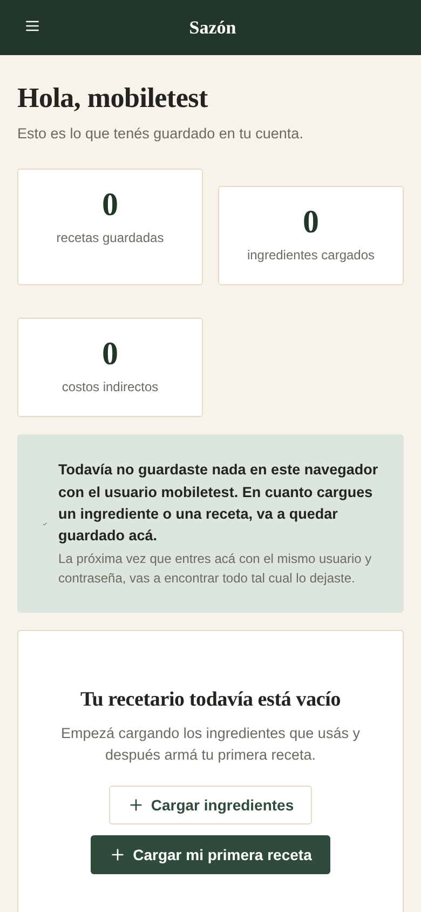
  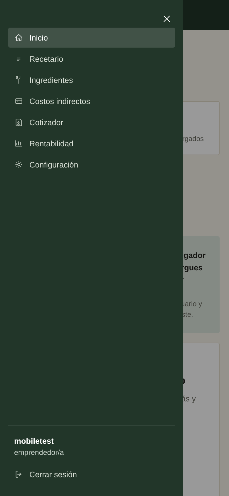
</p>

---

## Cómo correr el proyecto

No requiere instalación ni build. Hay dos formas de usarlo:

**Opción A — abrir el archivo directamente**
```bash
git clone https://github.com/Migarzabal024/sazon.git
cd sazon
# abrir index.html con el navegador (doble clic, o arrastrarlo a una pestaña)
```

**Opción B — servirlo localmente** (recomendado para que las fuentes web y
alguna funcionalidad del navegador se comporten exactamente igual que en un
sitio publicado)
```bash
cd sazon
python3 -m http.server 8080
# abrir http://localhost:8080 en el navegador
```

**Opción C — GitHub Pages**
Activando GitHub Pages sobre este repo (rama `main`, carpeta raíz), queda un
link público para compartir y probar sin que nadie tenga que clonar nada.

---

## Estructura del repo

```
sazon/
├── index.html              # La aplicación completa (HTML + CSS + JS, sin dependencias)
├── docs/
│   └── especificacion-mvp.md   # Especificación funcional y técnica completa del MVP
├── screenshots/             # Capturas reales de la app usadas en este README
└── README.md
```

## Cómo funciona el cálculo

```
Costo directo   = Σ (cantidad de cada ingrediente × costo por unidad de ese ingrediente)
Costo indirecto = Σ costos indirectos asignados a la receta (prorrateados si corresponde)
Costo total     = Costo directo + Costo indirecto
Costo por unidad = Costo total ÷ rendimiento de la receta

Precio de venta = (Costo por unidad + Ganancia deseada) ÷ (1 − % impuesto − % comisión del canal)
```

La app muestra tanto el **margen sobre el costo** (lo que gana en relación a
lo que gastó) como el **margen sobre el precio de venta** (lo que gana en
relación a lo que cobra), porque son dos lecturas distintas del mismo número
y confundirlas es un error común al poner precios.

El detalle completo de reglas de negocio, modelo de datos y flujos está en
[`docs/especificacion-mvp.md`](docs/especificacion-mvp.md).

---

## Estado y limitaciones

Este es un **prototipo funcional**, pensado para validar el producto antes de
invertir en un backend propio. Concretamente:

- El registro de usuarios y todas las recetas/ingredientes/cotizaciones se
  guardan en el `localStorage` del navegador — **no viajan entre
  dispositivos ni navegadores**, y se pierden si se borra el historial o se
  usa una ventana privada que bloquea el almacenamiento (la app avisa si
  esto último ocurre).
- No hay recuperación de contraseña ni verificación de email.
- No hay registro de ventas reales todavía (solo cotización/simulación).

Ninguna de estas limitaciones afecta la lógica de costeo ni la experiencia
de uso — son, a propósito, lo último que falta antes de pasar a producción.

## Roadmap

- [ ] Backend real (Supabase/Firebase) para cuentas accesibles desde
      cualquier dispositivo.
- [ ] Registro de ventas reales y comparación estimado vs. real.
- [ ] Exportar cotizaciones como imagen/PDF para compartir con clientes.
- [ ] Control de stock de ingredientes.
- [ ] Escalado de recetas (recalcular todo al producir el doble o la mitad).
- [ ] Roles de equipo (empleados con permisos limitados).

---

¿Encontraste un bug o tenés una idea para el producto? Abrí un
[issue](../../issues) en este repositorio.
