# 🥄 Sazón — Recetario y costeo para emprendedores gastronómicos

**Sazón** es una app pensada para emprendedores gastronómicos: reposteros, cocineros,
catering, food trucks y productores artesanales de alimentos. Combina en un solo
lugar:

- Un **recetario virtual** (ingredientes, pasos, fotos, tiempos, rendimiento).
- El **cálculo automático del costo de producción** de cada receta.
- Un **cotizador** que sugiere el precio de venta según el margen de ganancia
  que el productor quiere obtener, descontando impuestos y comisiones de venta.
- Un **panel de rentabilidad** para comparar qué recetas convienen más.

Cada usuario se registra con su propio usuario y contraseña, y ve únicamente
sus propias recetas, ingredientes y cotizaciones.

> **Estado del proyecto: MVP / prototipo funcional, ya pensado para producción.**
> Todo lo descripto en este README funciona de verdad. Es una SPA construida con
> **TypeScript + Vite + Bootstrap 5**, compilada a estáticos y desplegada
> automáticamente en **GitHub Pages**. Lo que todavía no tiene es un backend
> propio: los datos se guardan en el navegador de cada usuario (ver
> [Estado y limitaciones](#estado-y-limitaciones)).

🔗 **App en vivo:** https://migarzabal024.github.io/sazon/
*(se publica sola en cada push a `main` — ver [Despliegue](#despliegue))*

---

## Tabla de contenidos

- [Demo rápida](#demo-rápida)
- [Instructivo de uso](#instructivo-de-uso)
  1. [Instructivo de bienvenida](#1-instructivo-de-bienvenida)
  2. [Crear tu cuenta](#2-crear-tu-cuenta)
  3. [Cargar tus ingredientes](#3-cargar-tus-ingredientes)
  4. [Cargar costos indirectos](#4-cargar-costos-indirectos-opcional)
  5. [Armar una receta](#5-armar-una-receta)
  6. [Pantalla de Inicio](#6-pantalla-de-inicio)
  7. [Cotizar un precio de venta](#7-cotizar-un-precio-de-venta)
  8. [Panel de Rentabilidad](#8-panel-de-rentabilidad)
  9. [Configuración](#9-configuración)
  10. [Uso desde el celular](#10-uso-desde-el-celular)
- [Cómo correr el proyecto](#cómo-correr-el-proyecto)
- [Despliegue](#despliegue)
- [Arquitectura y stack técnico](#arquitectura-y-stack-técnico)
- [Estructura del repo](#estructura-del-repo)
- [Cómo funciona el cálculo](#cómo-funciona-el-cálculo)
- [Estado y limitaciones](#estado-y-limitaciones)
- [Roadmap](#roadmap)

---

## Demo rápida

La forma más rápida de probarla es entrar directamente a la app ya publicada:

👉 **https://migarzabal024.github.io/sazon/**

Para correrla en tu máquina, ver [Cómo correr el proyecto](#cómo-correr-el-proyecto).

---

## Instructivo de uso

### 1. Instructivo de bienvenida

Cada vez que se abre la app sin una sesión iniciada, aparece primero un
instructivo tipo carrusel que explica qué hace Sazón: recetario, ingredientes,
costos indirectos, cotizador y rentabilidad. Se navega con una flechita que
desliza las pantallas de derecha a izquierda, o se puede saltar directamente.

<p align="center">
  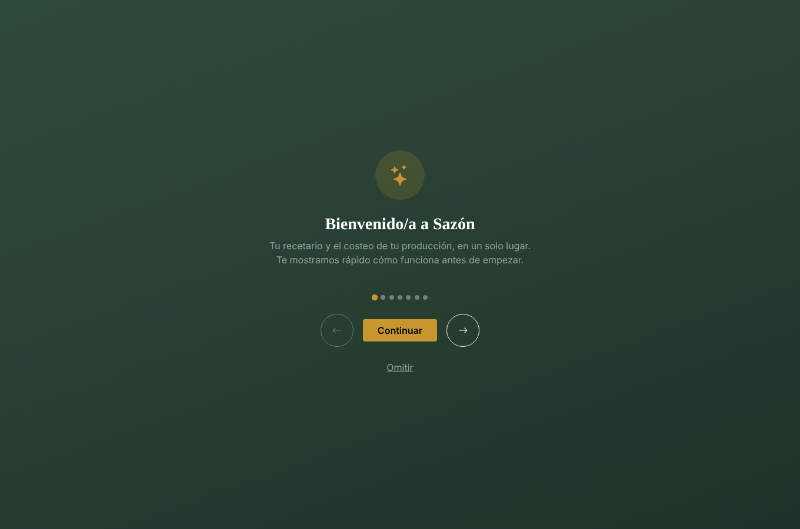
  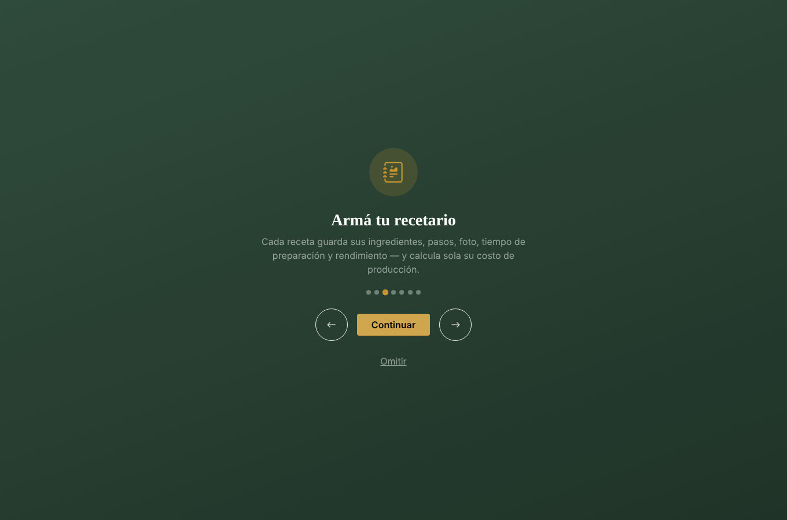
</p>
<p align="center">
  
</p>

### 2. Crear tu cuenta

Al confirmar el instructivo (o si tocás "Omitir"), se llega a la pantalla de
acceso. Ahí se crea una cuenta con usuario y contraseña propios — no hace
falta email ni verificación, es un registro simple pensado para el MVP.

<p align="center">
  
</p>

### 3. Cargar tus ingredientes

Desde **Ingredientes** se registra lo que se compra: nombre, cantidad y
unidad de compra, y el precio pagado. La app calcula sola el costo por
gramo, mililitro o unidad — ese valor es el que después usa cualquier receta
que incluya ese ingrediente.

<p align="center">
  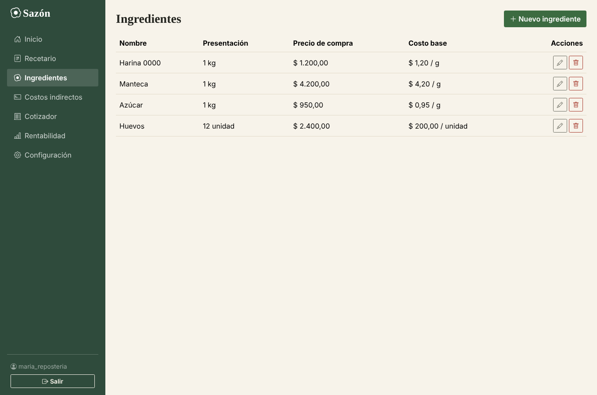
</p>

Si más adelante cambia el precio de un ingrediente, alcanza con editarlo una
vez: todas las recetas que lo usan recalculan su costo automáticamente.

### 4. Cargar costos indirectos (opcional)

Desde **Costos indirectos** se cargan gastos de producción que no son un
ingrediente puntual (packaging, gas, mano de obra, alquiler prorrateado,
etc.), ya sea como monto fijo por lote o como monto ya calculado por unidad.

<p align="center">
  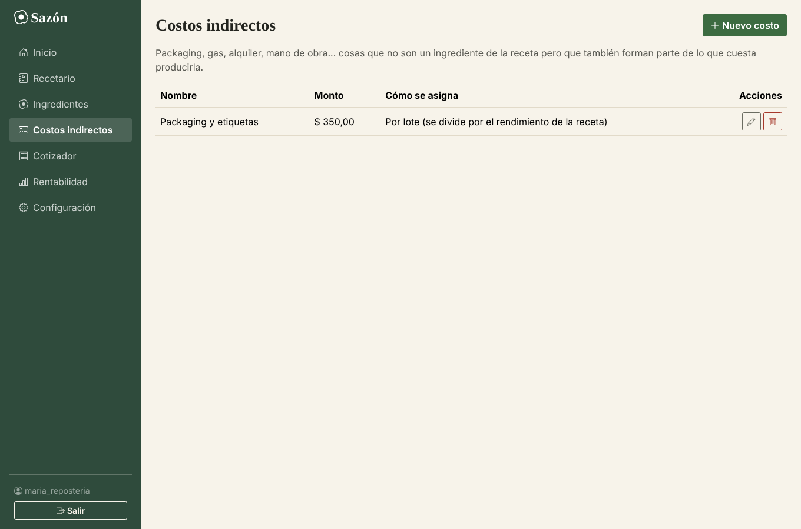
</p>

### 5. Armar una receta

Cada receta guarda nombre, categoría, foto, tiempo de preparación,
rendimiento (cuántas unidades da), la lista de ingredientes con sus
cantidades, los costos indirectos que le correspondan y los pasos de
preparación. El costo de producción (directo + indirecto, total y por
unidad) se recalcula en vivo a medida que se completa el formulario.

<p align="center">
  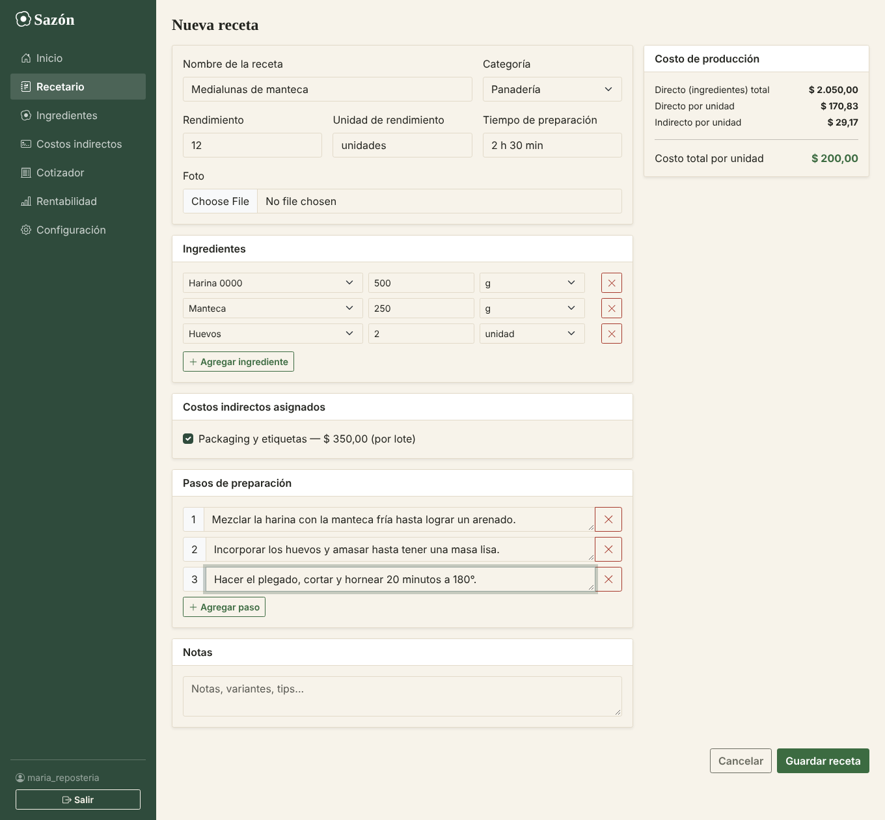
</p>

Una vez guardada, la receta aparece en el recetario con su foto y su costo
por unidad:

<p align="center">
  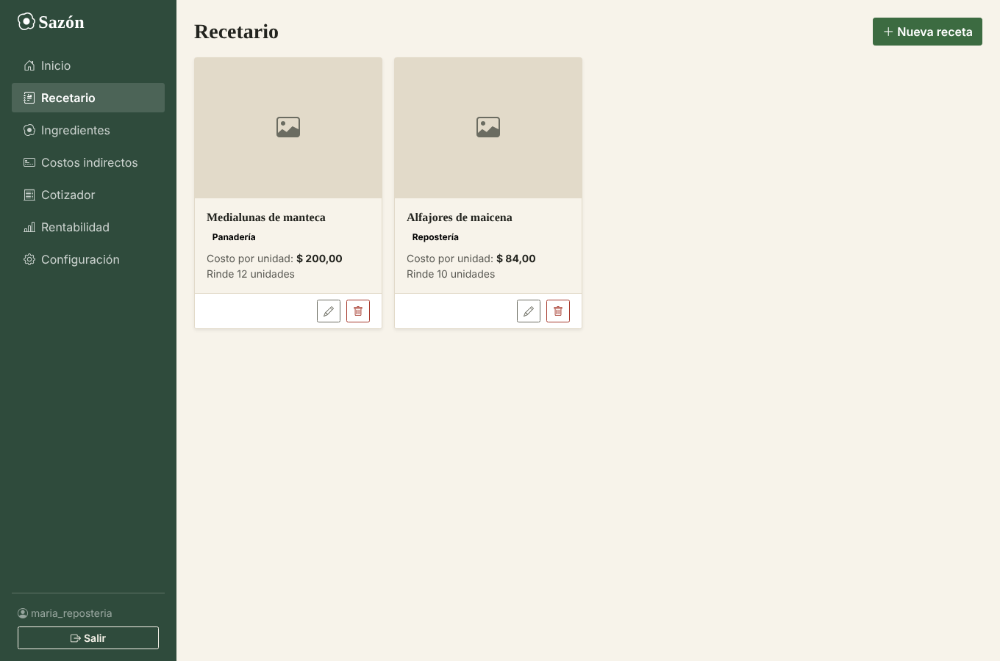
</p>

### 6. Pantalla de Inicio

Es lo primero que se ve al entrar ya logueado: cuántas recetas, ingredientes
y costos indirectos hay cargados, cuándo se guardó por última vez, y accesos
directos a las últimas recetas.

<p align="center">
  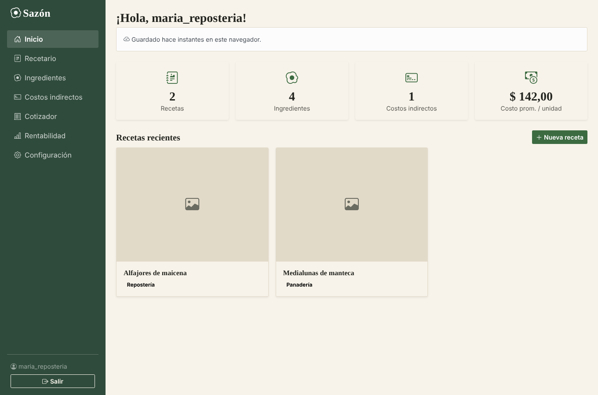
</p>

### 7. Cotizar un precio de venta

Desde **Cotizador** se elige una receta, un canal de venta (cada uno con su
comisión) y el margen de ganancia deseado — sobre el costo o sobre el precio
de venta. La app devuelve el precio sugerido, la ganancia neta por unidad, y
ambos márgenes (sobre costo y sobre venta) por separado, porque son números
distintos y es fácil confundirlos.

<p align="center">
  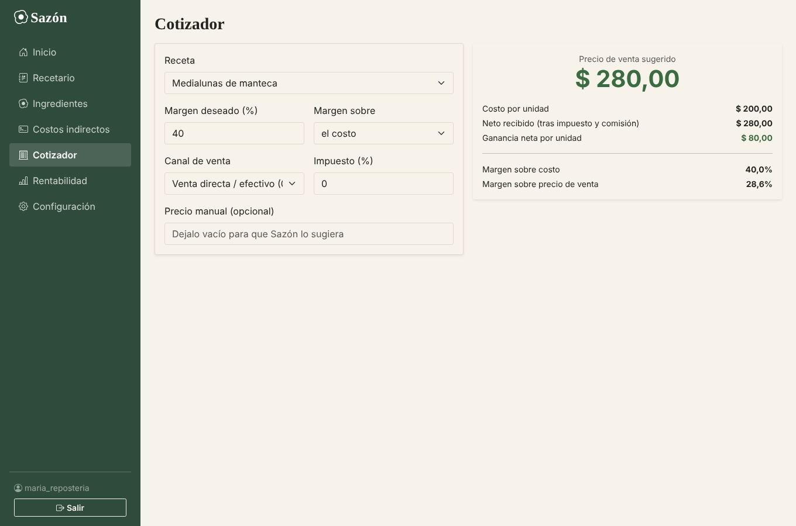
</p>

También se puede forzar un precio manual y ver qué margen real queda con ese
precio.

### 8. Panel de Rentabilidad

Compara todas las recetas ordenadas por margen, con un indicador visual de
cuáles están por debajo del margen mínimo que se definió en Configuración.

<p align="center">
  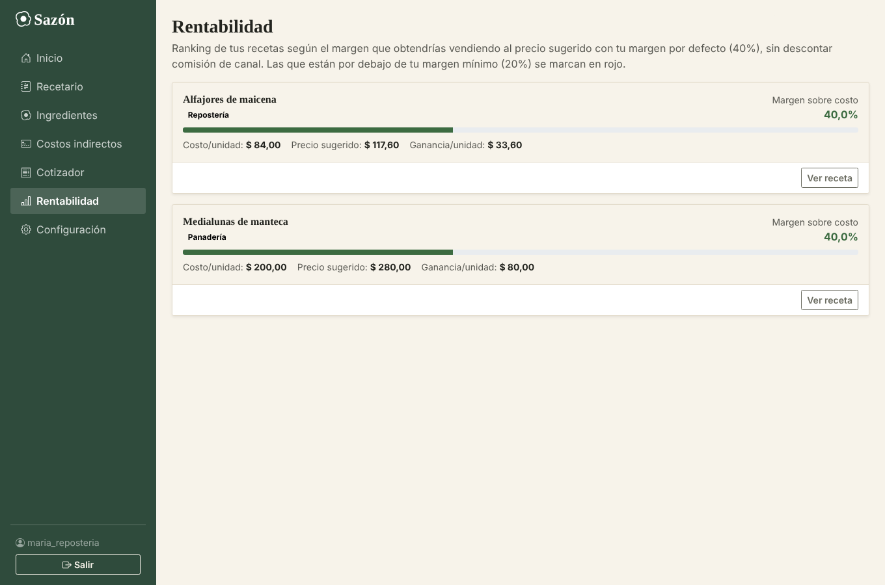
</p>

### 9. Configuración

Moneda (multi-moneda), margen e impuesto por defecto, margen mínimo
aceptable para las alertas, y los canales de venta con su comisión. Desde acá
también se puede volver a ver el instructivo de bienvenida en cualquier
momento.

<p align="center">
  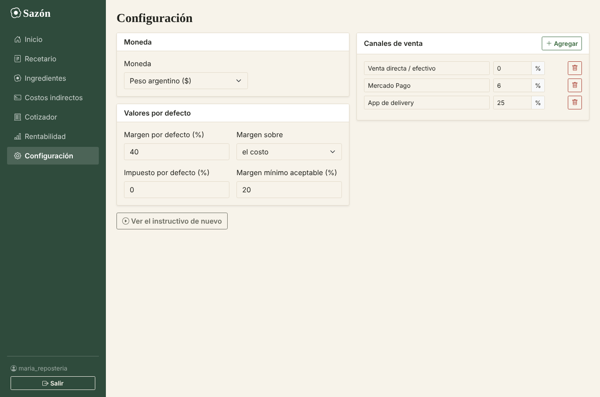
</p>

### 10. Uso desde el celular

La interfaz es responsive: en pantallas chicas el menú lateral se convierte
en un botón de menú (offcanvas de Bootstrap) arriba a la izquierda.

<p align="center">
  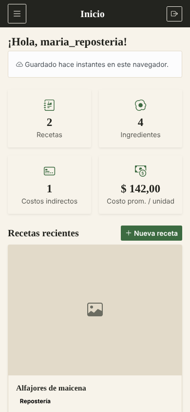
  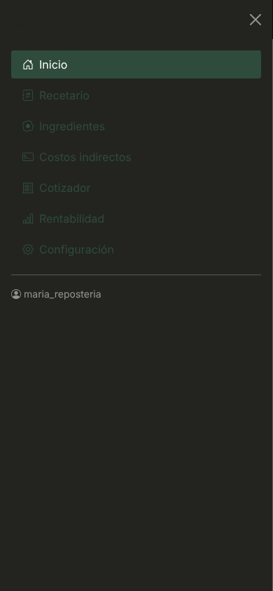
</p>

---

## Cómo correr el proyecto

Requiere [Node.js](https://nodejs.org/) 20 o superior.

```bash
git clone https://github.com/Migarzabal024/sazon.git
cd sazon
npm install

npm run dev       # servidor de desarrollo con recarga en vivo
npm run build     # build de producción a dist/
npm run preview   # sirve el build de dist/ localmente, tal como queda publicado
```

---

## Despliegue

El repo incluye un workflow de **GitHub Actions**
(`.github/workflows/deploy.yml`) que en cada push a `main`:

1. Instala dependencias (`npm ci`).
2. Compila el proyecto (`npm run build`), que corre `tsc` para chequear tipos
   y `vite build` para generar los estáticos en `dist/`.
3. Publica `dist/` en **GitHub Pages**.

**Paso único manual** (ya hecho para este repo, pero importante si lo cloná
para un fork propio): en GitHub, ir a **Settings → Pages** y elegir
**Source: GitHub Actions**. A partir de ahí, cada push a `main` despliega
solo, sin tocar nada más.

El `base` de Vite está configurado en `vite.config.ts` como `/sazon/`, que es
el path bajo el que GitHub Pages sirve este repo
(`https://<usuario>.github.io/sazon/`). Si se renombra el repo o se usa un
dominio propio, hay que actualizar ese valor.

---

## Arquitectura y stack técnico

- **TypeScript** de punta a punta, compilado y empaquetado con **Vite**.
- **Bootstrap 5** como framework de UI, pero **retemado con Sass** (no con el
  celeste por defecto): la paleta de marca (verde `#2F4B3C`, dorado
  `#C7962E`, crema `#F7F3EA`) y la tipografía (Fraunces + IBM Plex Sans) se
  definen sobrescribiendo las variables de Sass de Bootstrap en
  `src/styles/_brand.scss` **antes** de importar `bootstrap/scss/bootstrap`,
  así que todos los componentes (botones, badges, formularios, focus rings)
  salen recoloreados de forma consistente.
- **Bootstrap Icons** para toda la iconografía.
- La app sigue un patrón de **render inmediato**: un único estado en memoria
  (`src/state.ts`) se vuelca a HTML en cada cambio (`src/render.ts`), y un
  solo listener delegado por tipo de evento (`src/events.ts`) interpreta
  atributos `data-action` / `data-bind` en el HTML generado. Por eso los
  modales, el offcanvas mobile y los toasts de Bootstrap se arman con sus
  clases CSS (`.show`, `.manual-show`) controladas por nuestro propio estado,
  **sin** usar las instancias JS de Bootstrap (`bootstrap.Modal`,
  `bootstrap.Offcanvas`, `bootstrap.Toast`) — esas asumen que el DOM que
  controlan no se recrea por fuera suyo, lo cual no es compatible con
  re-renderizar todo el árbol en cada cambio de estado.
- El carrusel del instructivo es la única parte que **no** se re-renderiza
  por completo en cada paso (`src/views/onboarding.ts` → `updateOnboardDOM`):
  muta directamente el nodo existente para que la transición CSS del
  deslizamiento se anime (si se recrea el nodo, el navegador no tiene un
  frame anterior del que partir).
- Persistencia en `localStorage` (`src/storage.ts`), con detección de
  almacenamiento bloqueado (modo privado / navegadores restringidos) y aviso
  en pantalla sin bloquear el uso de la app.

## Estructura del repo

```
sazon/
├── index.html                  # Entry point de Vite
├── vite.config.ts              # base: '/sazon/' para GitHub Pages
├── tsconfig.json
├── package.json
├── .github/workflows/deploy.yml  # build + deploy automático a GitHub Pages
├── src/
│   ├── main.ts                 # punto de entrada: primer render + wireEvents
│   ├── types.ts                # modelo de datos (Receta, Ingrediente, Config, etc.)
│   ├── calc.ts                  # lógica pura de costeo y cotización
│   ├── storage.ts              # localStorage: DB, sesión, detección de bloqueo
│   ├── state.ts                 # estado global en memoria + helpers (money, uid...)
│   ├── path.ts                  # helpers de binding genérico (getPath/setPath)
│   ├── photo.ts                 # redimensionado/compresión de fotos con canvas
│   ├── render.ts                 # render() principal, goto, showToast, persist
│   ├── events.ts                 # un único listener delegado: toda la lógica de acciones
│   ├── styles/
│   │   ├── _brand.scss          # variables de marca sobre Bootstrap (Sass)
│   │   └── main.scss            # @import bootstrap + estilos propios
│   └── views/                   # una función de render por pantalla
│       ├── onboarding.ts, auth.ts, shell.ts, shared.ts
│       ├── inicio.ts, recetario.ts, ingredientes.ts, costos.ts
│       └── cotizador.ts, rentabilidad.ts, config.ts
├── legacy/
│   └── prototipo-original.html  # el prototipo de un solo archivo (HTML+CSS+JS) previo a esta reescritura, archivado como referencia
├── docs/
│   └── especificacion-mvp.md    # especificación funcional y técnica completa del MVP
├── screenshots/                 # capturas reales de la app usadas en este README
└── README.md
```

## Cómo funciona el cálculo

```
Costo directo   = Σ (cantidad de cada ingrediente × costo por unidad de ese ingrediente)
Costo indirecto = Σ costos indirectos asignados a la receta (prorrateados si corresponde)
Costo total     = Costo directo + Costo indirecto
Costo por unidad = Costo total ÷ rendimiento de la receta

Precio de venta = (Costo por unidad + Ganancia deseada) ÷ (1 − % impuesto − % comisión del canal)
```

La app muestra tanto el **margen sobre el costo** (lo que gana en relación a
lo que gastó) como el **margen sobre el precio de venta** (lo que gana en
relación a lo que cobra), porque son dos lecturas distintas del mismo número
y confundirlas es un error común al poner precios. La implementación exacta
está en [`src/calc.ts`](src/calc.ts).

El detalle completo de reglas de negocio, modelo de datos y flujos está en
[`docs/especificacion-mvp.md`](docs/especificacion-mvp.md).

---

## Estado y limitaciones

Este es un **prototipo funcional**, pensado para validar el producto antes de
invertir en un backend propio. Concretamente:

- El registro de usuarios y todas las recetas/ingredientes/cotizaciones se
  guardan en el `localStorage` del navegador — **no viajan entre
  dispositivos ni navegadores**, y se pierden si se borra el historial o se
  usa una ventana privada que bloquea el almacenamiento (la app avisa si
  esto último ocurre).
- No hay recuperación de contraseña ni verificación de email.
- No hay registro de ventas reales todavía (solo cotización/simulación).

Ninguna de estas limitaciones afecta la lógica de costeo ni la experiencia
de uso — son, a propósito, lo último que falta antes de pasar a un backend
real.

## Roadmap

- [ ] Backend real (Supabase/Firebase) para cuentas accesibles desde
      cualquier dispositivo.
- [ ] Registro de ventas reales y comparación estimado vs. real.
- [ ] Exportar cotizaciones como imagen/PDF para compartir con clientes.
- [ ] Control de stock de ingredientes.
- [ ] Escalado de recetas (recalcular todo al producir el doble o la mitad).
- [ ] Roles de equipo (empleados con permisos limitados).
- [ ] Modo oscuro.

---

¿Encontraste un bug o tenés una idea para el producto? Abrí un
[issue](../../issues) en este repositorio.
